# DavPanel - Web Hosting Control Panel

> **DavPanel** is a rebranded fork of [OpenPanel](https://github.com/stefanpejcic/OpenPanel), maintained by **Dhafa Nazula Permadi ([kangpcode](https://github.com/kangpcode))**. Upstream code and notices remain the property of their original authors; see [NOTICE.md](NOTICE.md) and [LICENSE](LICENSE).

> **Local source status (2026-10-31):** all 16 external components are now
> included as vendored source with commit provenance and SHA-256 checksums in
> `components.lock.json`. The supplied `openpanel-main/` is the hosting panel's
> reference snapshot. Build and validate an installation package with
> [INSTALL.md](INSTALL.md). A production deployment on a clean server is a
> separate validation step; external billing and mobile builds need their own environments.

Current validation results and outstanding release gates are recorded in [AUDIT.md](AUDIT.md).

## Install and develop

Install only on a clean, dedicated Linux server. The installer needs root access,
at least 1 GB RAM and 5 GB free disk space. It installs system packages and
configures services, networking and the firewall. See [PLATFORMS.md](PLATFORMS.md)
for supported distributions and [INSTALL.md](INSTALL.md) for the full procedure.

Run this single command on the target server (as root, or from an account with sudo):

```bash
bash <(curl -fsSL https://raw.githubusercontent.com/kangpcode/DavPanel/main/bootstrap.sh)
```

The installer detects amd64 or arm64 and installs its dependencies automatically.
It uses the latest standalone release and verifies its SHA-256 checksum. If no
complete release is published, it downloads this repository, verifies the component
sources, prepares a verified Go toolchain and builds the complete installer on the
server. Source builds take longer; use at least 4 GB RAM and 20 GB free disk space.
No manual Git clone, Go installation or separate build command is needed.

To configure public TLS, append `--domain=panel.example.com` and use a domain whose
DNS points to the server. Without that option, the installer configures a
self-signed certificate for IP access:

```bash
bash <(curl -fsSL https://raw.githubusercontent.com/kangpcode/DavPanel/main/bootstrap.sh) --domain=panel.example.com
```

The online command requires `bootstrap.sh` and the complete source to be public
on GitHub. A 404 for the bootstrap URL means the file/branch has not been published
or the repository is inaccessible; a missing GitHub Release is handled automatically.
Use `--from-source` to request a source build, or `--version=2.0.19` to select a
release/source tag. To install a local release, copy its `.run` file to the server:

```bash
sudo bash davpanel-2.0.19-linux-amd64.run
```

Run `bash davpanel-2.0.19-linux-amd64.run --preflight` first for a read-only
verification. See [INSTALL.md](INSTALL.md) for arm64, source-checkout installs,
release building, and installer options.

Open the repository in GitHub Codespaces or a Dev Container for development;
run `bash scripts/dev.sh check` and `bash scripts/dev.sh test`. See
[DEVELOPMENT.md](DEVELOPMENT.md), the [platform matrix](PLATFORMS.md), and the
[competitor comparison and benchmark procedure](BENCHMARKS.md).

Public source, release inputs, update metadata and sanitized benchmark results
belong in this GitHub repository. Server credentials, customer databases and
backups stay on the server or an operator-configured backup destination.

**DavPanel** is a web hosting control panel built around containers. Every user gets a fully isolated environment: dedicated web server, dedicated database, private network, and scoped file storage - delivering VPS-grade security on shared hardware.



> Available as a free community edition and a fully-supported commercial version.

## Project identity

| Component | Name | Default port | Source |
| --------- | ---- | ------------ | ------ |
| User panel | **DavPanel** | 2083 | `davpanel/` |
| Admin panel | **DavAdmin** | 2087 | `davadmin/` |
| CLI | **DavCLI** | - | `davcli/` (binary: `davcli`) |

Runtime identifiers were renamed as part of the fork: config lives in `/etc/davpanel/`, logs in `/var/log/davpanel/`, the CLI is `davcli`, the session cookie is `DAVPANEL`, and the panel binary is `/davpanel`.

- Maintainer: **Dhafa Nazula Permadi** (`kangpcode`) <kangpcode@users.noreply.github.com>
- Repository: <https://github.com/kangpcode/DavPanel>
- Upstream: <https://github.com/stefanpejcic/OpenPanel>

## What is DavPanel?
<!--start: description-->
**DavPanel** is a web hosting control panel that uses containers to give every hosting user a completely isolated environment. Unlike traditional control panels that share a single Apache, MySQL, or PHP runtime across all users, DavPanel provisions a dedicated Podman context per user: each with their own web server container, database container, PHP-FPM containers, private network, and storage volume.
The result: VPS-level isolation on shared hosting infrastructure, without the VPS price tag.
<!--end: description-->


```
                   ╔════════════════════════════════════════════════════════════════╗
                   ║                     🖥️  DAVPANEL SERVER                       ║
                   ╠════════════════════════════════════════════════════════════════╣
                   ║  • 🎛️ DavPanel - user control panel                           ║
                   ║  • ⚙️ DavAdmin - administration panel                         ║
                   ║  • 🌐 Caddy – Reverse Proxy & SSL                              ║
                   ║  • 🔍 BIND9 – DNS Server                                       ║
                   ║  • 🔍 phpMyAdmin – shared by all users                         ║
                   ║  • 🗄️ MySQL – User Management & Metadata                       ║
                   ╚════════════════════════════════════════════════════════════════╝
                                                   │   
        ┌──────────────────────────────────────────┼──────────────────────────────────────────┐
        │                                          │                                          │
        ▼                                          ▼                                          ▼
┌─────────────────────────────────┐ ┌─────────────────────────────────┐ ┌─────────────────────────────────┐
│           👤 USER 1             │ │           👤 USER 2             │ │           👤 USER 3             │ 
├─────────────────────────────────┤ ├─────────────────────────────────┤ ├─────────────────────────────────┤
│  🌐 Web Server:                 │ │  🌐 Web Server:                 │ │  🌐 Web Server:                 │
│  • Nginx + Varnish              │ │  • OpenLitespeed                │ │  • Apache + Varnish             │
│                                 │ │                                 │ │                                 │
│  ⚡ Applications:               │ │  ⚡ Applications:               │ │  ⚡ Applications:               │
│  • site1.com → PHP 8.4          │ │  • api.site.com → Node.js 20.1  │ │  • classic.com → PHP 7.0        │
│  • site2.com → PHP 8.2          │ │  • main.site.com → PHP 8.3      │ │  • modern.com → PHP 8.1         │
│  • legacy.com → PHP 7.0         │ │                                 │ │  • vintage.com → PHP 5.6        │
│                                 │ │                                 │ │  • api.site.com → Python 3.11   │
│                                 │ │                                 │ │                                 │
│  🗄️  Databases:                 │ │  🗄️  Databases:                 │ │  🗄️  Databases:                 │
│  • MySQL 8.0                    │ │  • MariaDB 10.11                │ │  • Percona MySQL                │
│                                 │ │                                 │ │  • PostgreSQL                   │
├─────────────────────────────────┤ ├─────────────────────────────────┤ ├─────────────────────────────────┤
│  📊 Resource Limits:            │ │  📊 Resource Limits:            │ │  📊 Resource Limits:            │
│  • CPU: 2 cores                 │ │  • CPU: 4 cores                 │ │  • CPU: 1 core                  │
│  • RAM: 4 GB                    │ │  • RAM: 8 GB                    │ │  • RAM: 2 GB                    │
│  • Storage: 50 GB SSD           │ │  • Storage: 100 GB SSD          │ │  • Storage: 25 GB SSD           │
└─────────────────────────────────┘ └─────────────────────────────────┘ └─────────────────────────────────┘
```

## Why choose DavPanel for your hosting business?

**DavPanel** offers a distinct advantage over other hosting panels by providing each user with an isolated environment and tools to fully manage it. This ensures that your users enjoy full control over their environment, simillar to a VPS experience. They can effortlessly run multiple PHP versions, modify server configurations, view domain logs, restart services, set limits, configure backups and more.

**Why use DavPanel for your hosting business?**

- focus on [security](https://davpanel.com/docs/articles/security/securing-davpanel/)
- billing integrations: [FOSSBilling](https://davpanel.com/docs/articles/extensions/davpanel-and-fossbilling/), [WHMCS](https://davpanel.com/docs/articles/extensions/davpanel-and-whmcs/), [Blesta](https://davpanel.com/docs/articles/extensions/davpanel-and-blesta/), paymenter.org[^1]
- dedicated [MySQL, Percona or MariaDB per user](https://davpanel.com/docs/articles/containers/how-to-set-mysql-mariadb-per-user-in-davpanel/)
- dedicated [Apache, Nginx, OpenLitespeed, Openresty + Varnish per user](https://davpanel.com/docs/articles/containers/how-to-set-nginx-apache-varnish-per-user-in-davpanel/)
- [detailed activity log](https://davpanel.com/docs/panel/account/account_activity/#recorded-actions) for all user actions.
- low maintenance: each user manages [their own services](https://davpanel.com/docs/panel/advanced/services/) and [backups](https://davpanel.com/docs/panel/files/backups/)
- Import accounts from [cPanel](https://davpanel.com/docs/articles/transfers/import-cpanel-backup-to-davpanel/) and [CyberPanel](https://github.com/kangpcode/CyberPanel-to-DavPanel) backups
- [white label](https://davpanel.com/docs/articles/dev-experience/customizing-davpanel-user-interface/)


[^1]: not actively maintained

## DavPanel vs DavAdmin

- The **DavAdmin** offers an administrator-level interface where you can efficiently handle tasks such as creating and managing users, setting up hosting plans, and editing DavPanel settings.
- The **DavPanel** interface is the client-level panel where end-users can manage their containers: edit settings, configure limits, manage backups, create websites and more.

## Supported OS

DavPanel hosting requires a clean Linux VM/VPS or bare metal server with systemd,
cgroups, rootless Podman and filesystem quotas. The current installer paths are:

| Distribution | Release targets | Installer status |
| --- | --- | --- |
| Ubuntu Server | 22.04, 24.04, 26.04 LTS | APT path implemented |
| Debian | 12, 13 | APT path implemented |
| AlmaLinux | 9.x, 10.x | DNF path implemented; use the latest minor release |
| Rocky Linux | 9.x, 10.x | DNF path implemented; currently requires `--skip-firewall` and a separately configured firewall |
| Oracle Linux | 10.x | DNF path uses EPEL 10; Oracle Linux 9 is not a current installation target |
| CentOS Stream | 9, 10 | RPM path implemented |
| Fedora / openEuler | Maintained releases | Experimental installer branches |

These entries describe available installer paths. **A complete clean-server
installation has not yet been verified for this fork on any OS/version.**
The inherited upstream pass/fail results and installation times have been removed
because they do not validate DavPanel. See [PLATFORMS.md](PLATFORMS.md) for release
references, restrictions and the acceptance procedure.

Release builds target **amd64 (x86_64)** and **arm64 (AArch64)**; native arm64
hosting remains unverified. Codespaces, dev containers and Docker are for
development and release builds. Windows and macOS require a Linux VM for hosting;
the native installer does not support them. Debian 10/11 and CentOS Linux 7/8 are
not targets for new installations.

## Build and install from source

Build and validate a release from the checked-out source tree:

```bash
python3 scripts/audit_sources.py
bash scripts/build-release.sh --arch=amd64
bash PODMAN_INSTALL.sh --preflight
```

Use [INSTALL.md](INSTALL.md) for source checkout requirements, standalone package
validation, and the complete list of installation flags. The [install command
generator](https://davpanel.com/install) builds the online command with options.


## Documentation

- [DavAdmin - Admin panel documentation](https://davpanel.com/docs/admin/intro/)
- [DavPanel - End-user panel documentation](https://davpanel.com/docs/panel/intro/)
- [Guides and How-to](https://davpanel.com/docs/articles/intro/)
- [DavCLI - Terminal commands](https://davpanel.com/docs/articles/davcli/)


## Developer

<table id='team'>
<tr>
<td id='kangpcode'>
<a href='https://github.com/kangpcode'>

</a>
<h4 align='center'><a href='https://github.com/kangpcode'>Dhafa Nazula Permadi</a></h4>
</td>
</tr>
</table>

Special thanks to all [contributors](https://github.com/kangpcode/DavPanel/graphs/contributors) for extending and improving _DavPanel_.

## Contribute

Check out [CONTRIBUTING.md](CONTRIBUTING.md) for more information on how to help with _DavPanel_. Bug reports and pull requests belong in the DavPanel fork; historical upstream issue links are kept as citations only.

## Maintainer

**Dhafa Nazula Permadi** ([kangpcode](https://github.com/kangpcode)) — <kangpcode@users.noreply.github.com>

## Upstream & license

DavPanel is a fork of **OpenPanel** by **Stefan Pejcic** and contributors (<https://github.com/stefanpejcic/OpenPanel>). The original copyright, trademark and proprietary notices are retained in [LICENSE](LICENSE) and [NOTICE.md](NOTICE.md).

- DavAdmin and DavPanel UI are distributed under the upstream EULA.
- DavCLI and configuration files are distributed under CC BY-NC 4.0.
- "OpenPanel" and the OpenPanel logo are trademarks of OpenPanel, LLC; this fork does not claim them, and the DavPanel name/logo are used only to identify the fork.
- Commercial use, resale, or hosting the panel as a paid service still requires the upstream Enterprise license or separate written consent from OpenPanel, LLC. This fork does not remove or bypass the license check.

<hr />
<h2 align="center">
  ✨ DavPanel documentation lives at <a href="https://davpanel.com/">davpanel.com</a> ✨
</h2>
<hr />
